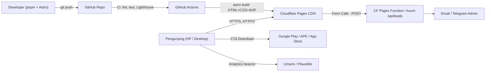
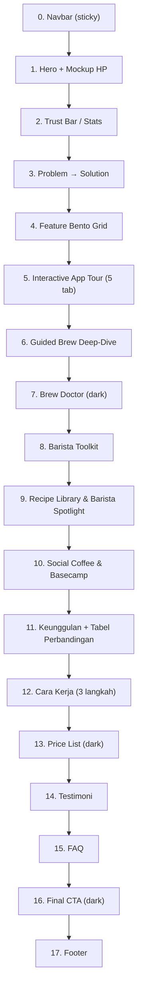

# Product Requirement Document — Coffee Labs Landing Page

> **Versi:** 1.0 · **Tanggal:** 23 Oktober 2026 · **Status:** Draft — siap review
> **Owner:** Rusdi (Product & Admin `rusdifn08`)
> **Dokumen pendamping:** [Design.md](./Design.md) (color palette, tipografi, komponen, token)
> **Produk yang dipasarkan:** Aplikasi mobile **Coffee Labs — *Master Your Brew*** (Flutter, `coffe-labs-mobile`) dengan backend Rust Axum + PostgreSQL (`coffe-labs-backend`, di-host di Render).

---

## Daftar Isi

1. [Ringkasan Eksekutif](#1-ringkasan-eksekutif)
2. [Hasil Analisis Aplikasi Mobile](#2-hasil-analisis-aplikasi-mobile)
3. [Tujuan, KPI & Non-Goals](#3-tujuan-kpi--non-goals)
4. [Target Pengguna & Persona](#4-target-pengguna--persona)
5. [Tech Stack](#5-tech-stack)
6. [Arsitektur & Struktur Proyek](#6-arsitektur--struktur-proyek)
7. [Information Architecture & Urutan Section](#7-information-architecture--urutan-section)
8. [Spesifikasi Detail Setiap Section](#8-spesifikasi-detail-setiap-section)
9. [Price List (Paket Harga)](#9-price-list-paket-harga)
10. [Kebutuhan Aset Screenshot Aplikasi](#10-kebutuhan-aset-screenshot-aplikasi)
11. [Non-Functional Requirements](#11-non-functional-requirements)
12. [SEO, Metadata & i18n](#12-seo-metadata--i18n)
13. [Analytics & Event Tracking](#13-analytics--event-tracking)
14. [Deployment & CI/CD](#14-deployment--cicd)
15. [Milestone & Timeline](#15-milestone--timeline)
16. [Risiko & Mitigasi](#16-risiko--mitigasi)
17. [Open Questions](#17-open-questions)
18. [Definition of Done](#18-definition-of-done)

---

## 1. Ringkasan Eksekutif

Coffee Labs adalah **"Specialty Coffee Brewing Hub"** di HP: pustaka resep seduh manual dari barista dunia, **Guided Brew timer** tahap-demi-tahap, **Brew Doctor** untuk koreksi rasa, **Cupping & Flavor Wheel SCA**, katalog **50 roastery Indonesia**, **Beans Radar**, **Jurnal Brew**, dan komunitas **Social Coffee**.

Landing page ini bertujuan menjadi **pintu masuk utama** (single-page, bilingual ID/EN) yang:
1. Menjelaskan nilai produk dalam < 5 detik (Hero),
2. **Menampilkan tampilan aplikasi asli** di dalam mockup HP pada setiap fitur,
3. Menjabarkan fitur & keunggulan,
4. Menyajikan **price list**,
5. Mengonversi pengunjung menjadi **pengguna Trial / pendaftar akun / pengunduh aplikasi**.

Dibangun dengan **Astro (static output, zero-JS by default) + Tailwind CSS v4**, target **Lighthouse 100/100/100/100**, **JS < 15 KB**, dan **total transfer halaman awal < 500 KB**.

---

## 2. Hasil Analisis Aplikasi Mobile

### 2.1 Gambaran Teknis Aplikasi

| Aspek | Temuan |
|-------|--------|
| Framework | Flutter (Dart SDK ^3.11), Material + Cupertino icons |
| Tema | Light, "Coffee inspired palette", font Poppins — [app_theme.dart](file:///c:/Rusdi/Coffe%20Labs/coffe-labs-mobile/lib/theme/app_theme.dart) |
| Navigasi | Bottom nav 5 tab: **Home · Recipes · Brew · Toolkit · Profile** — [main_layout.dart](file:///c:/Rusdi/Coffe%20Labs/coffe-labs-mobile/lib/screens/main_layout.dart) |
| Splash | "Coffee Labs" — *Master Your Brew* — [splash_screen.dart](file:///c:/Rusdi/Coffe%20Labs/coffe-labs-mobile/lib/screens/splash_screen.dart) |
| Bahasa | Bilingual **English (default) & Bahasa Indonesia** — [language_service.dart](file:///c:/Rusdi/Coffe%20Labs/coffe-labs-mobile/lib/services/language_service.dart), [coffee_translator.dart](file:///c:/Rusdi/Coffe%20Labs/coffe-labs-mobile/lib/services/coffee_translator.dart) |
| Update | **Shorebird OTA code push** + Version Gatekeeper (force update / patch) — [app_update_service.dart](file:///c:/Rusdi/Coffe%20Labs/coffe-labs-mobile/lib/services/app_update_service.dart) |
| Akun | Register → **approval Admin** → login penuh; atau **Mode Trial** — [auth_service.dart](file:///c:/Rusdi/Coffe%20Labs/coffe-labs-mobile/lib/services/auth_service.dart), [onboarding_screen.dart](file:///c:/Rusdi/Coffe%20Labs/coffe-labs-mobile/lib/screens/onboarding_screen.dart) |
| Backend | Rust **Axum 0.7 + SQLx (PostgreSQL) + JWT + bcrypt**, cloud di Render |
| Offline | Seed data resep & aset avatar/cover dibundel di app (bisa dipakai tanpa internet) — [seed_data.dart](file:///c:/Rusdi/Coffe%20Labs/coffe-labs-mobile/lib/services/seed_data.dart) |
| Platform build | Android, iOS, Web, Windows, macOS, Linux (target utama: Android) |

### 2.2 Data & Konten di Dalam App (angka untuk copywriting)

| Data | Jumlah | Sumber |
|------|--------|--------|
| Resep seduh dunia | **159 resep** (V60 Pour Over 88, Japanese Iced 18, Immersion 12, Flat Bottom 12, Hybrid 10, Origami 9, Cone 5, Hybrid Switch 4, Hybrid Immersion 1) | `seed_data.dart` |
| Barista / brewer pembuat resep | **97 nama unik** (mis. Tetsu Kasuya 🇯🇵) | `seed_data.dart`, [barista_catalog.dart](file:///c:/Rusdi/Coffe%20Labs/coffe-labs-mobile/lib/data/barista_catalog.dart) |
| Roastery Indonesia | **50 roastery** + lineup kopi & harga /100 g | [roastery_catalog.dart](file:///c:/Rusdi/Coffe%20Labs/coffe-labs-mobile/lib/data/roastery_catalog.dart) |
| Dripper | **13** (Hario V60 02, V60 + Es, Hario Switch, Origami Air S, Kalita Wave 185, Orea V4/April, AeroPress, French Press, Clever, Chemex/Kono, Pulsar/Gina, dst.) | [brew_visual_catalog.dart](file:///c:/Rusdi/Coffe%20Labs/coffe-labs-mobile/lib/data/brew_visual_catalog.dart) |
| Biji kopi Nusantara | **49** (Sumatra & Aceh, Jawa, Bali & NTT, Sulawesi, Papua) | `brew_visual_catalog.dart` |
| Flavor notes | **92** | `brew_visual_catalog.dart` |
| Model grinder (konverter klik) | **29** (Comandante C40, 1Zpresso JX Pro/K-Ultra/Q2, Timemore C2/C3/X-Lite/Sculptor, Kingrinder K2/K6, DF64 Gen2, Fellow Ode Gen2, Mahlkönig EK43, Eureka Mignon, Baratza Encore, Kinu M47, MHW-3Bomber, dll.) | `brew_visual_catalog.dart`, `assets/images/grinders` |
| Varietas kopi | **30+** (Bourbon, Typica, Geisha, S-795, Pacamara, Sidra, …) | [flavor_wheel_screen.dart](file:///c:/Rusdi/Coffe%20Labs/coffe-labs-mobile/lib/screens/flavor_wheel_screen.dart) |
| Efek audio | click, tick, water, transition, enjoy, calm music | `assets/audio` |

### 2.3 Inventaris Fitur (dipetakan ke Section Landing Page)

| # | Fitur App | Detail Kemampuan | File | Section LP |
|---|-----------|------------------|------|------------|
| F1 | **Home Dashboard** | Sapaan sesuai waktu, *"Mau brew apa hari ini?"*, **Barista Spotlight** (12 avatar), **Paling Sering Dipakai**, **Baru Dicoba** (riwayat) | [home_screen.dart](file:///c:/Rusdi/Coffe%20Labs/coffe-labs-mobile/lib/screens/home_screen.dart) | Hero, App Tour |
| F2 | **World Recipes** | Pencarian (barista, biji, dripper, notes), filter kategori/jumlah tuangan/dripper/barista/notes/origin, tab notes (Fruity & Tropical, Cokelat & Manis, Nutty & Rempah, Teh & Fermentasi, Mouthfeel & Body), **Surprise Me** (resep acak) | [recipe_feed_screen.dart](file:///c:/Rusdi/Coffe%20Labs/coffe-labs-mobile/lib/screens/recipe_feed_screen.dart) | Recipe Library |
| F3 | **Recipe Detail** | **Auto-Scale dosis kopi**, parameter (dosis, suhu, total waktu, **TDS air**), **Grinder Converter**, tasting notes, **Checklist persiapan**, filosofi & teknik ekstraksi, tahapan seduh (+g → target g), duplikasi ke My Custom Brews, **print struk Bluetooth** | [recipe_detail_screen.dart](file:///c:/Rusdi/Coffe%20Labs/coffe-labs-mobile/lib/screens/recipe_detail_screen.dart) | Recipe Library, Feature Bento |
| F4 | **Guided Brew Timer** | Hitung mundur "SIAP SEDUH", tahap per tahap (Blooming, Tuang 2, …), prev/next/reset, **+10 detik per tahap**, audio cue (tick/water/transition) | [brew_timer_screen.dart](file:///c:/Rusdi/Coffe%20Labs/coffe-labs-mobile/lib/screens/brew_timer_screen.dart) | Guided Brew |
| F5 | **Brew Doctor & Sensory Evaluation** | Slider Acidity / Sweetness / Bitterness / Body / Overall → diagnosis otomatis (*Sweet Spot 🎯*, *Under-Extracted*, *Over-Extracted*, *Low Body*) + saran koreksi (grind ±1–2 klik, suhu ±2°C, agitasi) → simpan ke Jurnal | `brew_timer_screen.dart` | Brew Doctor |
| F6 | **My Custom Brews / Buat Resep** | Builder resep: varietas, roast level, proses pasca-panen, notes, grinder, step tuangan, suhu, mode Japanese Iced | [brew_selection_screen.dart](file:///c:/Rusdi/Coffe%20Labs/coffe-labs-mobile/lib/screens/brew_selection_screen.dart), [add_recipe_screen.dart](file:///c:/Rusdi/Coffe%20Labs/coffe-labs-mobile/lib/screens/add_recipe_screen.dart) | Feature Bento |
| F7 | **Barista Toolkit — "Professional Suite"** | 6 tools: Favorite, Cupping Flavour, Coffee Roastery, Beans Radar, Jurnal Brew, Social Coffee | [toolkit_screen.dart](file:///c:/Rusdi/Coffe%20Labs/coffe-labs-mobile/lib/screens/toolkit_screen.dart) | Toolkit |
| F8 | **Cupping & Flavor Wheel** | Form cupping SCA, katalog varietas 30+, proses pasca-panen, flavor kustom, aftertaste, mouthfeel, contoh demo skor **90.75**, simpan ke journal | `flavor_wheel_screen.dart` | Toolkit |
| F9 | **Coffee Roastery** | 50 roastery, cari varian/varietas, filter Light/Medium/Dark roast, harga /100 g | [coffee_roastery_screen.dart](file:///c:/Rusdi/Coffe%20Labs/coffe-labs-mobile/lib/screens/coffee_roastery_screen.dart) | Toolkit |
| F10 | **Beans Radar** | Kalibrasi lokasi, roastery/biji terdekat, "Ready Beans", radius seluruh Indonesia, **Rute Maps**, **Beli Biji Kopi** | [bean_radar_screen.dart](file:///c:/Rusdi/Coffe%20Labs/coffe-labs-mobile/lib/screens/bean_radar_screen.dart) | Toolkit |
| F11 | **Jurnal Brew** | Log seduh, rating, catatan grind, hasil sensory | [brew_journal_screen.dart](file:///c:/Rusdi/Coffe%20Labs/coffe-labs-mobile/lib/screens/brew_journal_screen.dart) | Toolkit |
| F12 | **Social Coffee + Basecamp** | Live feed "Komunitas Seduh", filter Semua/🔥Terpopuler/📖Resep, like, komentar, **Copy Resep** → langsung brew, tag topik (Aeropress, Origami, JapaneseIced…), **Basecamp** (grup komunitas, private group) | [social_coffee_screen.dart](file:///c:/Rusdi/Coffe%20Labs/coffe-labs-mobile/lib/screens/social_coffee_screen.dart), [basecamp_screen.dart](file:///c:/Rusdi/Coffe%20Labs/coffe-labs-mobile/lib/screens/basecamp_screen.dart) | Community |
| F13 | **Barista Profile** | Profil barista + cover, daftar resepnya | [barista_profile_screen.dart](file:///c:/Rusdi/Coffe%20Labs/coffe-labs-mobile/lib/screens/barista_profile_screen.dart) | Recipe Library |
| F14 | **Profile & Settings** | Avatar karakter, nama barista, ganti password, bahasa ID/EN, feedback/bug report, cek update OTA | [profile_screen.dart](file:///c:/Rusdi/Coffe%20Labs/coffe-labs-mobile/lib/screens/profile_screen.dart), [settings_screen.dart](file:///c:/Rusdi/Coffe%20Labs/coffe-labs-mobile/lib/screens/settings_screen.dart) | Keunggulan |
| F15 | **Thermal Receipt (Bluetooth)** | Cetak struk resep/hasil seduh ke printer kasir Bluetooth — cocok untuk coffee shop | [receipt_print_service.dart](file:///c:/Rusdi/Coffe%20Labs/coffe-labs-mobile/lib/services/receipt_print_service.dart), [thermal_receipt_sheet.dart](file:///c:/Rusdi/Coffe%20Labs/coffe-labs-mobile/lib/widgets/thermal_receipt_sheet.dart) | Pricing (Café), Bento |
| F16 | **Mode Trial** | 10 resep pertama + **10× seduh**; setelah habis terkunci **7 hari** lalu reset otomatis | [trial_service.dart](file:///c:/Rusdi/Coffe%20Labs/coffe-labs-mobile/lib/services/trial_service.dart) | Pricing, FAQ |
| F17 | **Feedback & Admin** | Feedback user, Admin Approval Hub, Admin Feedback, Version Gatekeeper | `feedback_screen.dart`, `admin_*_screen.dart` | *(tidak ditampilkan — internal)* |

**Fitur yang sudah ada kodenya namun belum terhubung ke navigasi** (tampilkan sebagai **"Segera Hadir / Roadmap"**): Kalkulator & Konverter Brew (rasio, Japanese Iced ice %, klik C40) — [brew_calculator_screen.dart](file:///c:/Rusdi/Coffe%20Labs/coffe-labs-mobile/lib/screens/brew_calculator_screen.dart); Taste Match (swipe deck resep); Smart Scale (simulasi timbangan); Marketplace.

### 2.4 Keunggulan Produk (Unique Selling Points)

1. **Resep dunia dalam satu aplikasi** — 159 resep dari 97 barista/brewer, terfilter berdasarkan dripper, jumlah tuangan, origin, dan flavor notes.
2. **Guided Brew + audio cue** — tidak perlu stopwatch & catatan terpisah; setiap tuangan dipandu gram & detik.
3. **Brew Doctor** — satu-satunya fitur yang langsung menerjemahkan rasa (asam/pahit/encer) menjadi **aksi koreksi** (klik grinder, suhu, agitasi).
4. **Auto-Scale & Grinder Converter 29 model** — resep apa pun bisa disesuaikan dengan dosis & grinder milik sendiri.
5. **Konten lokal Indonesia** — 50 roastery, 49 biji Nusantara, Beans Radar se-Indonesia.
6. **Toolkit profesional** — Cupping SCA, Jurnal, print struk Bluetooth (siap untuk coffee shop).
7. **Komunitas** — Social Coffee + Basecamp, salin resep teman dan langsung seduh.
8. **Bilingual & offline-ready** — ID/EN, data resep tersedia tanpa internet.
9. **Selalu terbaru** — pembaruan instan via OTA (Shorebird) tanpa reinstall.

---

## 3. Tujuan, KPI & Non-Goals

### 3.1 Tujuan Bisnis
- **G1:** Meningkatkan unduhan/instal aplikasi.
- **G2:** Meningkatkan jumlah pengguna **Mode Trial** → konversi ke akun berbayar/resmi.
- **G3:** Membangun kredibilitas brand sebagai *brewing hub* specialty coffee No. 1 di Indonesia.
- **G4:** Menjaring leads B2B (coffee shop) untuk paket Café.

### 3.2 KPI (90 hari setelah launch)

| KPI | Target |
|-----|--------|
| CTR tombol Download/Trial (dari total sesi) | ≥ 12% |
| Scroll depth ke section Pricing | ≥ 45% sesi |
| Bounce rate | ≤ 45% |
| Leads paket Café (form) | ≥ 30 / bulan |
| Core Web Vitals (p75, mobile) | LCP ≤ 1.8 s · INP ≤ 100 ms · CLS ≤ 0.05 |
| Lighthouse (mobile) | ≥ 98 pada keempat kategori |

### 3.3 Non-Goals (v1)
- Tidak ada sistem login/akun di website.
- Tidak ada pembayaran online langsung di website (checkout via app/Play Billing atau WhatsApp untuk Café) — lihat Open Questions.
- Tidak ada blog/CMS pada v1 (struktur disiapkan untuk v2 via Astro Content Collections).
- Tidak ada dark mode sistem.

---

## 4. Target Pengguna & Persona

| Persona | Profil | Pain Point | Pesan Kunci | CTA |
|---------|--------|------------|-------------|-----|
| **Dimas — Home Brewer Pemula** (22–30 th) | Baru beli V60 & grinder manual | Rasa tidak konsisten, bingung rasio & grind | "Ikuti panduan barista juara, tahap demi tahap." | Coba Gratis |
| **Sari — Enthusiast** (25–40 th) | Punya banyak dripper, koleksi beans | Catatan seduh tercecer, sulit cari resep sesuai beans | "Semua resep, jurnal & cupping di satu app." | Barista Pro |
| **Bima — Barista Profesional** | Kerja di coffee shop / ikut kompetisi | Butuh tools cupping, kalibrasi, berbagi resep tim | "Professional Suite di saku Anda." | Barista Pro |
| **Owner Coffee Shop** | Kelola 1–5 outlet | Standarisasi resep antar barista, struk resep | "Standarkan rasa di semua bar Anda." | Hubungi Sales (Café) |

---

## 5. Tech Stack

### 5.1 Keputusan Utama

> **Framework terpilih: Astro (versi stabil terbaru, ≥ 5.x) dengan `output: 'static'`.**
> Alasan: Astro mengirim **0 KB JavaScript secara default** (HTML + CSS murni). JS hanya dikirim untuk "island" interaktif yang benar-benar butuh, sehingga **paling ringan**, **memakai memori browser paling sedikit**, dan saat ini merupakan **framework terbaik untuk landing page/content site** berdasarkan performa Core Web Vitals.

### 5.2 Perbandingan Framework

| Kriteria | **Astro** ✅ | Next.js (App Router) | SvelteKit | Qwik | Eleventy (11ty) |
|----------|-----------|----------------------|-----------|------|-----------------|
| JS default ke browser | **0 KB** | ~85–100 KB (React runtime) | ~15–25 KB | ~1 KB (resumable) | 0 KB |
| Memori runtime di browser | **Sangat rendah** (tanpa hydration global) | Tinggi (React tree + hydration) | Rendah | Rendah | Sangat rendah |
| Komponen modern (`.astro`, Islands, View Transitions) | ✅ | ✅ | ✅ | ✅ | ❌ (template saja) |
| Optimasi gambar bawaan (AVIF/WebP, srcset) | ✅ `astro:assets` | ✅ (butuh server/edge) | Plugin | Plugin | Plugin |
| i18n routing bawaan | ✅ | ✅ | Manual/lib | Manual | Manual |
| Ekosistem & dokumentasi | Besar | Sangat besar | Besar | Kecil | Sedang |
| Hosting statis murni (CDN, gratis) | ✅ | Parsial | ✅ (adapter-static) | ✅ | ✅ |
| Cocok untuk landing page | **Terbaik** | Overkill | Bagus | Bagus, ekosistem kecil | Bagus, DX lebih sederhana |

### 5.3 Daftar Lengkap Tech Stack

| Layer | Pilihan | Versi target | Alasan / Catatan |
|-------|---------|--------------|------------------|
| Framework | **Astro** | latest stable (≥ 5.x) | Static Site Generation, zero-JS default, Islands |
| Bahasa | **TypeScript** (strict) | 5.x | Type-safety konten & props |
| Styling | **Tailwind CSS v4** via `@tailwindcss/vite` | 4.x | Engine Oxide (Rust), CSS-first `@theme`, output CSS hanya kelas terpakai (~10–15 KB gzip) |
| Interaktivitas | **Vanilla TS** dalam `<script>` Astro (di-bundle & di-defer otomatis) | — | Untuk: toggle harga, tab App Tour, menu mobile, toggle bahasa. **Tanpa framework UI runtime.** |
| Island opsional | **Preact** (`@astrojs/preact`) *hanya jika* butuh komponen stateful kompleks | 10.x | ~4 KB; **default tidak dipakai** |
| Accordion/Dialog | Elemen native `<details name>` & `<dialog>` | — | 0 KB JS |
| Animasi | **CSS scroll-driven animations** + `@property` + View Transitions API | — | Tanpa GSAP/Framer |
| Ikon | `astro-icon` + `@iconify-json/lucide` | latest | SVG inline saat build, 0 JS |
| Font | `@fontsource/poppins` (400/500/600/700) + `@fontsource-variable/fraunces` (italic) | latest | Self-host, WOFF2, subset latin |
| Gambar | `astro:assets` (`<Image>`, `<Picture>`) dengan **Sharp** | bawaan | AVIF + WebP, `srcset`, ukuran eksplisit (anti-CLS) |
| Konten | **Astro Content Collections** (`src/content/*.json|yaml`) + skema **Zod** | bawaan | Fitur, pricing, FAQ, testimoni terpisah dari markup |
| i18n | Astro i18n routing (`/` = ID, `/en/` = EN) | bawaan | `hreflang`, sitemap per locale |
| SEO | `@astrojs/sitemap`, JSON-LD manual (`SoftwareApplication`, `FAQPage`, `Organization`) | latest | Rich result |
| Kompresi aset | `astro-compress` *(opsional)* atau minify bawaan Vite | latest | HTML/CSS/SVG minify |
| Analytics | **Umami** (self-host) atau **Plausible** | latest | Script < 2 KB, tanpa cookie, ramah privasi |
| Form leads (Café) | **Cloudflare Pages Functions / Worker** → email/Telegram, atau endpoint baru di backend Axum (`POST /api/leads`) | — | Tidak menambah JS besar; progressive enhancement (form tetap jalan tanpa JS) |
| Lint & Format | ESLint (flat config) + `eslint-plugin-astro`, Prettier + `prettier-plugin-astro` + `prettier-plugin-tailwindcss` | latest | Konsistensi |
| Testing | **Playwright** (smoke + visual), **Lighthouse CI**, **axe-core** (a11y) | latest | Quality gate di CI |
| Package manager | **pnpm** | 9.x+ | Instal cepat, hemat disk |
| Runtime build | Node.js LTS | 22.x+ | — |
| Hosting | **Cloudflare Pages** (utama) atau Vercel/Netlify (static) | — | CDN global + PoP Jakarta/Singapura, gratis, HTTP/3, Brotli |
| Domain | `coffeelabs.id` *(usulan)* | — | Open question |

### 5.4 Budget Performa (hard limit — CI gagal bila terlampaui)

| Resource | Budget |
|----------|--------|
| HTML awal (gzip) | ≤ 35 KB |
| CSS total (gzip) | ≤ 20 KB (critical CSS inline otomatis oleh Astro untuk stylesheet kecil) |
| JavaScript total (gzip) | **≤ 15 KB** |
| Font | ≤ 90 KB (≤ 2 file di-preload) |
| Gambar above-the-fold | ≤ 120 KB (hero mockup AVIF) |
| Total transfer saat first load | **≤ 500 KB** |
| Total halaman penuh (setelah scroll, lazy) | ≤ 1.8 MB |
| Request awal | ≤ 20 |
| Memori JS heap (Chrome, mobile emulation) | ≤ 5 MB |

---

## 6. Arsitektur & Struktur Proyek

### 6.1 Diagram Arsitektur



### 6.2 Struktur Folder (rencana)

```
coffee-labs-landing/
├─ astro.config.mjs          # output:'static', i18n, sitemap, icon
├─ package.json
├─ tsconfig.json
├─ public/
│  ├─ favicon.svg  apple-touch-icon.png  og-image.jpg
│  └─ robots.txt
└─ src/
   ├─ assets/
   │  ├─ screens/{id,en}/    # screenshot app (PNG master → di-optimasi Astro)
   │  ├─ baristas/  grinders/  photos/
   │  └─ logo.svg
   ├─ components/
   │  ├─ ui/        Button.astro  Badge.astro  Card.astro  Icon.astro  Section.astro
   │  ├─ mockup/    PhoneMockup.astro  PhoneStack.astro
   │  └─ sections/  Navbar  Hero  TrustBar  ProblemSolution  FeatureBento  AppTour
   │                GuidedBrew  BrewDoctor  Toolkit  RecipeLibrary  Community
   │                Advantages  HowItWorks  Pricing  Testimonials  FAQ  FinalCTA  Footer
   ├─ content/
   │  ├─ config.ts            # skema Zod
   │  ├─ features/{id,en}.json
   │  ├─ pricing/{id,en}.json
   │  ├─ faq/{id,en}.json
   │  └─ testimonials/{id,en}.json
   ├─ i18n/ ui.ts  utils.ts
   ├─ layouts/ BaseLayout.astro   # <head>, SEO, JSON-LD, font preload
   ├─ pages/
   │  ├─ index.astro          # ID (default)
   │  ├─ en/index.astro       # EN
   │  ├─ privacy.astro  terms.astro
   │  └─ 404.astro
   ├─ scripts/ pricing-toggle.ts  app-tour.ts  nav.ts
   └─ styles/ global.css      # token Tailwind v4 dari Design.md §13
```

### 6.3 Aturan Implementasi
- Semua section = komponen `.astro` **tanpa** `client:*` directive kecuali benar-benar diperlukan.
- Teks tidak di-hardcode di komponen → ambil dari `content/` atau `i18n/ui.ts`.
- Setiap `` wajib `width`, `height`, `alt`, `loading` (lazy kecuali hero), `decoding="async"`.
- Script kecil per-komponen ditulis di `<script>` Astro (otomatis `type="module"`, deferred, di-bundle).

---

## 7. Information Architecture & Urutan Section



Anchor navigasi: `#fitur` (4), `#tur-aplikasi` (5), `#toolkit` (8), `#harga` (13), `#faq` (15).

---

## 8. Spesifikasi Detail Setiap Section

> Format tiap section: **Tujuan · Layout (Desktop / Mobile) · Konten & Copy (ID / EN) · Visual & Mockup · Interaksi · Acceptance Criteria**.
> Token warna/komponen merujuk ke [Design.md](./Design.md).

---

### 8.0 Navbar (Sticky)

- **Tujuan:** Navigasi cepat + CTA selalu terlihat.
- **Layout Desktop:** tinggi 64 px, container 1200 px. Kiri logo + "Coffee Labs"; tengah link *Fitur · Tur Aplikasi · Toolkit · Harga · FAQ*; kanan toggle `ID | EN` + Button Primary `sm` **"Coba Gratis"**.
- **Layout Mobile:** tinggi 56 px; logo + Button Primary `sm` + hamburger → `<dialog>` full-screen berisi link besar (48 px) & 2 store badge.
- **Visual:** glass cream (Design §6.4), border bawah muncul setelah scroll.
- **Interaksi:** link anchor smooth-scroll (`scroll-behavior: smooth`, `scroll-margin-top: 80px`); **active link highlight** via IntersectionObserver (< 1 KB).
- **AC:**
  - [ ] Tetap terlihat saat scroll, tidak menutupi heading anchor.
  - [ ] Menu mobile bisa ditutup dengan `Esc`, klik backdrop, dan tombol ✕; fokus terkunci di dalam dialog.
  - [ ] Toggle bahasa mempertahankan anchor (`/en/#harga`).

---

### 8.1 Hero Section ⭐

- **Tujuan:** Dalam 5 detik pengunjung paham: *ini aplikasi panduan seduh kopi manual ala barista profesional, gratis dicoba.*
- **Background:** `--gradient-crema` + glow amber di belakang mockup + pola biji kopi 4% + 3 garis uap kopi (SVG animasi CSS).
- **Layout Desktop (≥ 1024 px):** grid 12 kolom → **kiri 6 kolom teks**, **kanan 6 kolom komposisi mockup**. Min-height `min(100svh, 860px)`.
- **Layout Mobile:** teks di atas (rata tengah), mockup di bawah (lebar 240 px), CTA full-width ditumpuk.

**Konten & Copy:**

| Elemen | ID (default) | EN |
|--------|--------------|----|
| Eyebrow badge | `☕ SPECIALTY COFFEE BREWING HUB` | `☕ SPECIALTY COFFEE BREWING HUB` |
| Headline (h1, `display`) | Seduh Kopi Presisi *Layaknya* Barista Juara. | Brew Like a *Champion* Barista. |
| Sub-headline | 159 resep dari 97 barista dunia, panduan seduh tahap demi tahap, dan Brew Doctor yang memberi tahu cara memperbaiki rasa — semuanya dalam satu aplikasi. | 159 recipes from 97 world-class brewers, step-by-step guided brewing, and a Brew Doctor that tells you exactly how to fix your cup — all in one app. |
| CTA Primary | **Coba Gratis Sekarang** → (ke store/APK) | **Try It Free** → |
| CTA Secondary (Outline) | ▶ Lihat Tur Aplikasi (→ `#tur-aplikasi`) | ▶ Take the App Tour |
| Microcopy | Gratis 10 resep & 10× seduh · Tanpa kartu kredit · Android | Free 10 recipes & 10 brews · No credit card · Android |
| Store badges | Google Play · Download APK · (App Store — "Segera") | idem |
| Social proof mini | 5 avatar barista bertumpuk + "Dipercaya home brewer & barista di seluruh Indonesia" | "Loved by home brewers & baristas across Indonesia" |

*Kata dalam italic menggunakan Fraunces Italic warna espresso.*

**Visual & Mockup (komposisi kanan):**
- **Mockup utama (flat, 300 px):** screenshot **Guided Brew Timer** saat tahap *Blooming — 0:30 — +30 g → 30 g*.
- **Mockup belakang (tilt-left -8°, 250 px, opacity 0.95):** screenshot **Home** ("Mau brew apa hari ini?" + Barista Spotlight).
- **Floating chips** (card putih kecil, shadow-md, animasi float 6 s naik-turun 6 px):
  - `🎯 Sweet Spot! Ekstraksi Seimbang` (kanan atas)
  - `🌡 93°C · ⚖ 15 g · 1:16` (kiri tengah)
  - `⏱ Blooming 0:30` dengan mini progress ring conic-gradient (kanan bawah)
- Mobile: hanya mockup utama + 1 chip.

**Interaksi:**
- Angka timer pada chip berdetak (CSS counter + `@property`), berhenti bila reduced-motion.
- CTA Primary: deteksi OS via `navigator.userAgent` sederhana → Android = Play Store/APK, iOS = halaman "Segera hadir / gabung waitlist", desktop = scroll ke QR code di Final CTA.

**AC:**
- [ ] Gambar hero adalah elemen LCP, di-preload, `fetchpriority="high"`, AVIF ≤ 120 KB.
- [ ] LCP ≤ 1.8 s di 4G mobile (Moto G Power profile).
- [ ] Headline terbaca penuh tanpa scroll di 360×740.
- [ ] Tidak ada CLS dari font/gambar (CLS ≤ 0.05).
- [ ] Hanya **1 tag `h1`** di seluruh halaman.

---

### 8.2 Trust Bar / Stats Strip

- **Tujuan:** Bukti skala & kredibilitas konten.
- **Layout:** strip putih, border atas-bawah sand. Desktop 4 kolom, mobile grid 2×2.
- **Konten:**

| Angka | Label ID | Label EN |
|-------|----------|----------|
| **159+** | Resep Seduh Dunia | World Brew Recipes |
| **97** | Barista & Brewer | Baristas & Brewers |
| **50** | Roastery Indonesia | Indonesian Roasteries |
| **29** | Model Grinder Didukung | Supported Grinders |

- Di bawahnya: marquee pelan (CSS `@keyframes`, pause on hover) berisi nama metode/dripper: *Hario V60 · Origami · Kalita Wave · AeroPress · Hario Switch · Chemex · Orea · Pulsar · French Press · Clever · Japanese Iced*.
- **Interaksi:** angka count-up saat terlihat (CSS `@property --num` + `animation-timeline: view()`; fallback angka statis).
- **AC:** [ ] Angka sesuai data aktual app (update di `content/` jika seed berubah). [ ] Marquee berhenti saat reduced-motion & dapat di-pause.

---

### 8.3 Problem → Solution

- **Tujuan:** Membangun empati dengan masalah home brewer.
- **Layout Desktop:** 2 kolom — kiri "Tanpa Coffee Labs" (kartu abu kehangatan, ikon ✕), kanan "Dengan Coffee Labs" (kartu putih border amber, ikon ✓). Mobile: tumpuk.
- **Judul:** "Kopi di kafe enak, tapi seduhan di rumah *kok beda?*" / EN: "Great at the café, but *not at home?*"

| Masalah (ID) | Solusi Coffee Labs (ID) |
|--------------|-------------------------|
| Rasa tidak konsisten tiap seduh | Guided Brew dengan gram & detik presisi tiap tuangan |
| Bingung kenapa kopi terlalu asam/pahit | Brew Doctor mendiagnosis & memberi koreksi grind/suhu |
| Resep barista tersebar di YouTube & IG | 159 resep terkurasi, bisa difilter dripper & notes |
| Resep pakai grinder berbeda | Grinder Converter 29 model + Auto-Scale dosis |
| Catatan seduh hilang | Jurnal Brew & Cupping tersimpan otomatis |

- **AC:** [ ] Teks EN tersedia lengkap. [ ] Ikon tidak satu-satunya penanda (ada label "Sebelum/Sesudah").

---

### 8.4 Feature Bento Grid (`#fitur`)

- **Tujuan:** Ringkasan visual semua fitur utama dengan potongan tampilan app.
- **Header:** eyebrow `FITUR UTAMA` · h2 "Semua yang Anda butuhkan untuk seduhan sempurna" · deskripsi 1 kalimat.
- **Layout Desktop (12 kolom, 3 baris):**

| Tile | Span | Isi | Screenshot (crop) |
|------|------|-----|-------------------|
| A. **Guided Brew Timer** | 6 col × 2 row | "Dipandu tiap tetes." + chip audio cue | Brew Timer (HP penuh, flat) |
| B. **World Recipes** | 6 col × 1 row | "159 resep, 97 barista, filter cerdas." | Recipe feed (crop atas) |
| C. **Brew Doctor** | 3 col × 1 row | "Asam? Pahit? Ini solusinya." | Panel diagnosis |
| D. **Auto-Scale & Grinder Converter** | 3 col × 1 row | "Resep menyesuaikan alatmu." | Recipe detail — slider dosis |
| E. **Cupping & Flavor Wheel** | 4 col | "Skoring SCA, 92 flavor notes." | Flavor wheel |
| F. **Social Coffee** | 4 col | "Salin resep teman, langsung seduh." | Feed post |
| G. **Print Struk Bluetooth** | 4 col | "Siap untuk bar & coffee shop." | Thermal receipt |

- **Layout Mobile:** 1 kolom, tile A–G berurutan; screenshot ditampilkan crop 60% tinggi.
- **Visual:** tile putih radius 32, tile A background `--gradient-espresso` dengan teks cream (variasi), lainnya putih. Ikon fitur memakai warna Toolkit (Design §3.3).
- **Interaksi:** hover tile → screenshot naik 8 px (`transform`) + shadow-lg.
- **AC:** [ ] Semua screenshot lazy-load, AVIF, dengan `alt`. [ ] Grid tidak overflow di 320 px.

---

### 8.5 Interactive App Tour (`#tur-aplikasi`) ⭐

- **Tujuan:** Memperlihatkan **tampilan aplikasi secara langsung** mengikuti 5 tab bottom navigation app.
- **Header:** eyebrow `TUR APLIKASI` · h2 "Lihat Coffee Labs beraksi" · deskripsi.
- **Layout Desktop:** kiri = daftar 5 tab (kartu vertikal, aktif = border kiri amber 3 px + bg putih); kanan = **PhoneMockup sticky** (`position: sticky; top: 15vh`). Saat user scroll (scrollytelling) **atau** klik tab, screenshot di mockup berganti (crossfade 400 ms).
- **Layout Mobile:** segmented tab horizontal (scroll-snap) di atas mockup; swipe horizontal antar screenshot (CSS `scroll-snap-type: x mandatory`, tanpa library carousel).

| Tab | Ikon | Judul | Deskripsi (ID) | Screenshot |
|-----|------|-------|----------------|------------|
| 1 | `house` | **Home** | Sapaan personal, Barista Spotlight, resep paling sering dipakai & riwayat seduh terakhir. | `home.png` |
| 2 | `book-open` | **Recipes** | Jelajahi 159 resep dunia. Cari berdasarkan barista, biji, dripper, notes — atau tekan *Surprise Me*. | `recipes.png` + `recipe_detail.png` |
| 3 | `timer` | **Brew** | Guided brewing dengan hitung mundur, tahap tuangan, audio cue, dan resep kustom Anda sendiri. | `brew_timer.png` + `my_custom_brews.png` |
| 4 | `wrench` | **Toolkit** | Professional Suite: Favorite, Cupping, Roastery, Beans Radar, Jurnal, Social Coffee. | `toolkit.png` |
| 5 | `user-round` | **Profile** | Avatar karakter, bahasa ID/EN, jurnal, favorit, feedback & update OTA. | `profile.png` |

- **Interaksi:** implementasi `app-tour.ts` (≤ 2 KB): IntersectionObserver pada tiap item → set `data-active` → CSS menampilkan gambar terkait. Tab ARIA pattern (`role="tablist"`, panah kiri/kanan).
- **AC:**
  - [ ] Bekerja tanpa JS (fallback: semua screenshot tampil berurutan).
  - [ ] Navigasi keyboard tab sesuai WAI-ARIA Tabs.
  - [ ] Screenshot non-aktif `loading="lazy"`, tidak memblok LCP.

---

### 8.6 Guided Brew Deep-Dive

- **Tujuan:** Menonjolkan fitur inti — seduh dipandu.
- **Layout Desktop:** 2 kolom — kiri mockup (Brew Timer, tilt-right), kanan teks + 4 poin. Mobile: teks → mockup.
- **Copy:** eyebrow `GUIDED BREW` · h2 "Setiap tuangan, *tepat waktu & tepat gram*." 
- **Poin fitur (ikon + judul + 1 kalimat):**
  1. **Hitung mundur "Siap Seduh"** — bersiap sebelum timer berjalan.
  2. **Tahap demi tahap** — Blooming, Tuang 2, Tuang 3… dengan target `+30 g → 60 g`.
  3. **Audio cue** — bunyi tick, air, dan transisi; mata tetap fokus pada kettle.
  4. **Fleksibel** — tambah +10 detik, mundur/maju tahap, reset kapan saja.
- **Visual tambahan:** animasi timeline horizontal 4 tahap (CSS) dengan progress bar amber.
- **AC:** [ ] Contoh angka konsisten dengan resep nyata di app (mis. Tetsu Kasuya 4:6).

---

### 8.7 Brew Doctor & Sensory Evaluation (Dark Section)

- **Tujuan:** USP terkuat — menerjemahkan rasa menjadi aksi.
- **Background:** `--gradient-roast` + grain.
- **Layout Desktop:** kiri teks + kartu diagnosis; kanan mockup layar Sensory Evaluation (slider). Mobile: tumpuk.
- **Copy:** eyebrow `BREW DOCTOR` (gold) · h2 "Kopi terlalu asam? *Brew Doctor tahu jawabannya.*" · sub "Nilai rasa seduhan Anda, dapatkan diagnosis ekstraksi dan saran koreksi instan."
- **Kartu diagnosis interaktif (3 tab chip):**

| Chip | Status | Saran |
|------|--------|-------|
| 😖 Terlalu Asam / Tipis | Under-Extracted | Grind lebih halus 1–2 klik · naikkan suhu +2°C · bloom lebih lama |
| 😣 Terlalu Pahit / Sepat | Over-Extracted | Grind lebih kasar 1–2 klik · turunkan suhu −2°C · kurangi agitasi |
| 💧 Encer / Kurang Body | Low Body | Naikkan dosis / rasio lebih pekat · grind sedikit lebih halus |
| 🎯 Seimbang | Sweet Spot! | Simpan ke Jurnal & ulangi resep ini |

- **Interaksi:** chip = radio input; konten berganti via CSS `:has(:checked)` (**0 JS**).
- **AC:** [ ] Kontras teks di dark ≥ 4.5:1. [ ] Status selalu berlabel teks (bukan warna saja).

---

### 8.8 Barista Toolkit — "Professional Suite" (`#toolkit`)

- **Tujuan:** Menunjukkan kedalaman fitur profesional.
- **Header:** badge `PROFESSIONAL SUITE` (gold, replika app) · h2 "Peralatan presisi barista, di saku Anda."
- **Layout Desktop:** kiri mockup Toolkit screen; kanan grid 2×3 kartu (replika `_buildSimpleCard` app: ikon gradient 36–48 px, judul 14–18 px bold, deskripsi). Mobile: grid 2 kolom, mockup di atas.

| Kartu | Deskripsi (ID) | Deskripsi (EN) |
|-------|----------------|----------------|
| ❤️ **Favorite** | Koleksi resep seduh favorit Anda | Your favorite brew recipes, saved |
| 🍊 **Cupping Flavour** | Form cupping SCA, 30+ varietas & 92 flavor notes | SCA cupping form, 30+ varieties, 92 notes |
| 🏭 **Coffee Roastery** | Katalog 50 roastery Indonesia & lineup kopinya | 50 Indonesian roasteries & their lineups |
| 📡 **Beans Radar** | Temukan biji kopi terdekat, rute Maps & beli langsung | Find beans nearby, route & buy |
| 📓 **Jurnal Brew** | Catatan ekstraksi, grind & rating harian | Daily extraction, grind & rating log |
| 💬 **Social Coffee** | Komunitas barista, diskusi & bagikan resep | Barista community & recipe sharing |

- **Sub-blok "Segera Hadir"** (chip outline + label `SOON`): Kalkulator & Konverter Brew · Taste Match · Smart Scale · Marketplace.
- **Interaksi:** klik kartu → modal `<dialog>` kecil berisi screenshot fitur terkait (lazy-load saat dibuka).
- **AC:** [ ] Warna ikon identik dengan app. [ ] Fitur "Segera Hadir" ditandai jelas agar tidak misleading.

---

### 8.9 Recipe Library & Barista Spotlight

- **Tujuan:** Memamerkan kekayaan konten resep.
- **Layout:** 
  - Baris 1: h2 "Resep dari barista terbaik dunia" + filter chip statis (V60 · Japanese Iced · Immersion · Flat Bottom · Hybrid · Origami).
  - Baris 2: **carousel horizontal recipe card** (replika kartu app 220 px: cover, judul, nama barista, chip kategori berwarna) — CSS scroll-snap, tombol prev/next kecil (JS ≤ 1 KB, opsional).
  - Baris 3: **Barista Spotlight** — deret avatar bulat (12) + "dan 85 lainnya".
  - Kanan (desktop): mockup Recipe Detail yang menyorot **Auto-Scale**, **Grinder Converter**, **Checklist Persiapan**, parameter (dosis · suhu · waktu · TDS).
- **Callout fitur:** 4 chip: `⚖ Auto-Scale Dosis` · `⚙ 29 Grinder` · `✅ Checklist Persiapan` · `🖨 Print Struk`.
- **AC:** [ ] Data kartu resep diambil dari JSON hasil ekspor `seed_data.dart` (8–12 resep pilihan). [ ] Disclaimer kecil: "Resep dikurasi/terinspirasi dari metode publik para barista; nama digunakan untuk atribusi."

---

### 8.10 Social Coffee & Basecamp (Community)

- **Tujuan:** Menunjukkan aspek komunitas.
- **Layout Desktop:** kiri teks, kanan **PhoneStack** (3 mockup bertumpuk: Feed, Detail Post + komentar, Basecamp). Mobile: 1 mockup + 2 thumbnail.
- **Copy:** eyebrow `KOMUNITAS SEDUH` · h2 "Berbagi resep, diskusi, dan *seduh bersama*."
- **Poin:** Live Feed (Semua · 🔥 Terpopuler · 📖 Resep Kopi) · Like & komentar · **Copy Resep → Mulai Brew Sekarang** · Tag topik (#V60 #Aeropress #Origami #JapaneseIced) · **Basecamp**: grup komunitas & private group.
- **AC:** [ ] Screenshot memakai data dummy yang sopan & tanpa data pribadi asli.

---

### 8.11 Keunggulan Aplikasi (Why Coffee Labs)

- **Tujuan:** Merangkum USP & membedakan dari alternatif.
- **Bagian A — 6 kartu keunggulan (grid 3×2 / mobile 1 kolom):**
  1. 🌍 **Konten Dunia + Lokal** — 159 resep global, 50 roastery & 49 biji Nusantara.
  2. 🩺 **Brew Doctor** — koreksi rasa berbasis diagnosis ekstraksi.
  3. ⚙️ **Personal** — Auto-Scale & konverter 29 grinder.
  4. 📴 **Offline-Ready** — resep & panduan bisa dipakai tanpa internet.
  5. 🌐 **Bilingual** — Bahasa Indonesia & English.
  6. ⚡ **Selalu Terbaru** — update instan OTA tanpa reinstall.
- **Bagian B — Tabel perbandingan:**

| Kemampuan | Coffee Labs | Stopwatch + Catatan | App Timer Kopi Umum |
|-----------|:-----------:|:-------------------:|:-------------------:|
| Resep barista terkurasi (159+) | ✅ | ❌ | ⚠️ Terbatas |
| Panduan gram & detik per tahap | ✅ | ❌ | ✅ |
| Diagnosis & koreksi rasa (Brew Doctor) | ✅ | ❌ | ❌ |
| Konverter grinder & auto-scale | ✅ | ❌ | ⚠️ |
| Cupping SCA & flavor wheel | ✅ | ❌ | ❌ |
| Katalog roastery & biji Indonesia | ✅ | ❌ | ❌ |
| Komunitas & berbagi resep | ✅ | ❌ | ⚠️ |
| Print struk Bluetooth | ✅ | ❌ | ❌ |
| Bahasa Indonesia | ✅ | — | ❌ |

- **Mobile:** tabel di-scroll horizontal dengan kolom pertama sticky.
- **AC:** [ ] Tidak menyebut merek kompetitor secara spesifik (hindari klaim yang dapat digugat).

---

### 8.12 Cara Kerja (How It Works)

- **Layout:** 3 langkah horizontal dengan garis penghubung putus-putus (desktop), vertikal timeline (mobile). Setiap langkah punya mockup kecil 200 px.

| # | Judul | Deskripsi | Screenshot |
|---|-------|-----------|------------|
| 1 | **Unduh & Mulai Trial** | Pasang aplikasi, pilih avatar, langsung coba 10 resep gratis. | Onboarding |
| 2 | **Pilih Resep** | Cari berdasarkan dripper, biji, atau barista favorit. | Recipes |
| 3 | **Seduh & Evaluasi** | Ikuti Guided Brew, nilai rasanya, biarkan Brew Doctor menyempurnakan. | Sensory Evaluation |

- **AC:** [ ] Langkah sesuai flow onboarding nyata (Register → approval Admin, atau Trial langsung).

---

### 8.13 Price List (`#harga`) — Dark Section ⭐

Lihat detail lengkap di **[§9 Price List](#9-price-list-paket-harga)**.

- **Layout Desktop:** header tengah + toggle **Bulanan / Tahunan (Hemat 28%)** + 3 kartu (tengah = Popular, sedikit lebih tinggi). Di bawah: strip "Paket Café" lebar penuh atau kartu ke-4 opsional; lalu baris jaminan (ikon: 🔒 Aman · ↩️ Batal kapan saja · 💬 Support WhatsApp).
- **Layout Mobile:** kartu bertumpuk, **Popular tampil pertama**; toggle tetap di atas (sticky dalam section).
- **Interaksi:** toggle via radio + CSS `:has()` menukar harga (**0 JS**); `pricing-toggle.ts` opsional hanya untuk analytics.
- **AC:**
  - [ ] Harga & fitur berasal dari `content/pricing/{id,en}.json` (mudah diubah tanpa sentuh komponen).
  - [ ] Harga dalam format `Rp29.000` (ID) / `IDR 29,000` (EN).
  - [ ] Setiap CTA ter-tracking (`pricing_cta_click` + `plan`).
  - [ ] Teks "Harga belum termasuk PPN" (jika berlaku) & link Syarat Layanan.

---

### 8.14 Testimoni

- **Layout:** masonry 3 kolom (desktop) / carousel scroll-snap (mobile). 6–9 kartu.
- **Konten tiap kartu:** rating ★★★★★ (gold), kutipan 1–3 kalimat, avatar, nama, peran ("Home Brewer, Bandung", "Head Barista, Jakarta").
- **Contoh placeholder:** *"Brew Doctor bikin saya akhirnya paham kenapa V60 saya selalu asam. Sekarang tiap pagi konsisten!"* — Dimas, Home Brewer.
- **AC:** [ ] **Wajib testimoni asli** dengan izin sebelum go-live (placeholder hanya untuk staging). [ ] Markup `Review` JSON-LD hanya jika data asli.

---

### 8.15 FAQ (`#faq`)

- **Layout:** container 720 px, accordion `<details name="faq">`; 2 kolom di ≥ 1280 px.
- **Daftar pertanyaan (ID):**
  1. **Apakah Coffee Labs gratis?** — Ya, Mode Trial gratis: 10 resep pertama & 10× seduh. Setelah kuota habis, fitur seduh terbuka lagi otomatis 7 hari kemudian. Upgrade untuk akses tanpa batas.
  2. **Kenapa akun saya perlu persetujuan Admin?** — Untuk menjaga kualitas komunitas. Sambil menunggu, Anda bisa langsung memakai Mode Trial.
  3. **Apakah bisa dipakai offline?** — Bisa. Resep & panduan seduh tersimpan di aplikasi; fitur komunitas & sinkronisasi butuh internet.
  4. **Grinder saya tidak ada di daftar?** — Tersedia 29 model + opsi "Universal Manual"; ajukan lewat menu Feedback.
  5. **Tersedia di iPhone?** — Saat ini Android; versi iOS segera hadir (gabung waitlist).
  6. **Bisa untuk coffee shop?** — Bisa. Paket Café mendukung multi-akun barista & print struk resep via printer thermal Bluetooth.
  7. **Bahasa apa saja yang didukung?** — Bahasa Indonesia & English, bisa diganti di Pengaturan.
  8. **Bagaimana cara update aplikasi?** — Pembaruan kecil masuk otomatis (OTA); pembaruan besar via store.
  9. **Bagaimana membatalkan langganan?** — Kapan saja melalui Google Play / pengaturan akun; akses tetap aktif hingga akhir periode.
- **AC:** [ ] JSON-LD `FAQPage` tervalidasi Rich Results Test. [ ] Hanya satu item terbuka sekaligus.

---

### 8.16 Final CTA (Dark Section)

- **Layout Desktop:** panel besar radius 32, `--gradient-roast`; kiri headline + CTA + store badges, kanan mockup tilt + **QR code** (SVG statis) untuk unduh dari desktop.
- **Copy:** h2 "Siap menyeduh kopi terbaik Anda?" · sub "Gabung bersama ribuan pecinta kopi. Mulai gratis hari ini." · CTA Primary **"Unduh Coffee Labs"** · CTA Ghost **"Hubungi Kami untuk Paket Café"**.
- **Opsional:** form waitlist iOS (email) — progressive enhancement, POST ke Pages Function.
- **AC:** [ ] QR code mengarah ke URL dengan UTM `utm_source=landing&utm_medium=qr`.

---

### 8.17 Footer

- **Layout:** 4 kolom (desktop) / accordion-like stack (mobile). Background `--color-roast-950`.
  - Kol 1: logo, tagline *Master Your Brew*, sosial media (Instagram, TikTok, YouTube, WhatsApp).
  - Kol 2 Produk: Fitur · Tur Aplikasi · Toolkit · Harga · Roadmap.
  - Kol 3 Dukungan: FAQ · Kontak · Laporkan Bug · Status Update.
  - Kol 4 Legal: Kebijakan Privasi · Syarat Layanan · Atribusi Resep.
- Baris bawah: © 2026 Coffee Labs · toggle bahasa · "Dibuat dengan ☕ di Indonesia".
- **AC:** [ ] Halaman `/privacy` & `/terms` tersedia (wajib untuk Google Play listing).

---

## 9. Price List (Paket Harga)

> ⚠️ **Catatan analisis:** saat ini aplikasi **belum memiliki sistem pembayaran**. Model yang ada: **Mode Trial** (10 resep, 10× seduh, lock 7 hari) dan **Akun Resmi** (register + approval Admin, akses penuh). Price list di bawah adalah **usulan model monetisasi** yang selaras dengan gating yang sudah ada di [trial_service.dart](file:///c:/Rusdi/Coffe%20Labs/coffe-labs-mobile/lib/services/trial_service.dart). Semua angka disimpan di `content/pricing/*.json` dan **wajib dikonfirmasi owner sebelum go-live**.

### 9.1 Tabel Paket

| | **Trial** | **Barista Pro** ⭐ Paling Populer | **Café / Business** |
|---|---|---|---|
| Untuk | Coba-coba & pemula | Home brewer serius & barista | Coffee shop 1–5 outlet |
| Harga Bulanan | **Rp0** | **Rp29.000 / bulan** | **Rp149.000 / outlet / bulan** |
| Harga Tahunan | **Rp0** | **Rp249.000 / tahun** (≈ Rp20.750/bln, hemat 28%) | **Rp1.490.000 / outlet / tahun** (2 bulan gratis) |
| CTA | Mulai Gratis | Upgrade ke Pro | Hubungi Sales |
| Akses resep dunia | 10 resep pertama | **159+ resep (semua)** | Semua + resep internal tim |
| Guided Brew | 10× seduh (reset 7 hari) | **Tanpa batas** | Tanpa batas |
| Brew Doctor & Sensory Evaluation | ✅ | ✅ | ✅ |
| Auto-Scale & Grinder Converter | ✅ | ✅ | ✅ |
| My Custom Brews | 3 resep | **Tanpa batas** | Tanpa batas + bagikan ke tim |
| Jurnal Brew & Cupping SCA | Dasar | **Lengkap** | Lengkap + rekap tim |
| Coffee Roastery & Beans Radar | ✅ | ✅ | ✅ |
| Social Coffee | Lihat saja | Posting, komentar, copy resep | ✅ |
| Basecamp | — | Gabung grup | **Buat private group tim** |
| Print struk Bluetooth | — | ✅ | ✅ |
| Jumlah akun barista | 1 | 1 | **Hingga 5 / outlet** |
| Dukungan | Komunitas | Email / in-app feedback | **Prioritas WhatsApp + onboarding** |
| Persetujuan akun | Tidak perlu | Otomatis setelah bayar | Otomatis + akun admin outlet |

### 9.2 Aturan Tampilan Harga
- Default toggle: **Tahunan** (menonjolkan penghematan); tampilkan harga per bulan setara dengan coretan harga bulanan (`~~Rp29.000~~ Rp20.750/bln`).
- Badge "Paling Populer" pada Barista Pro; badge "Hemat 28%" pada toggle Tahunan.
- Opsional: **Promo Early Bird** (mis. "Diskon 40% untuk 500 pengguna pertama") via flag `promo.enabled` di JSON.
- Mata uang tunggal IDR pada v1.

### 9.3 Skema JSON (contoh)

```json
{
  "currency": "IDR",
  "defaultBilling": "yearly",
  "plans": [
    {
      "id": "trial", "name": "Trial", "popular": false,
      "price": { "monthly": 0, "yearly": 0 },
      "cta": { "label": "Mulai Gratis", "href": "/download?plan=trial" },
      "features": [
        { "text": "10 resep pertama", "included": true },
        { "text": "10× Guided Brew (reset 7 hari)", "included": true },
        { "text": "Print struk Bluetooth", "included": false }
      ]
    },
    {
      "id": "pro", "name": "Barista Pro", "popular": true,
      "price": { "monthly": 29000, "yearly": 249000 }
    },
    {
      "id": "cafe", "name": "Café / Business", "popular": false,
      "price": { "monthly": 149000, "yearly": 1490000 }, "unit": "outlet",
      "cta": { "label": "Hubungi Sales", "href": "#kontak-cafe" }
    }
  ]
}
```

---

## 10. Kebutuhan Aset Screenshot Aplikasi

**Spesifikasi:** PNG master 1290×2796 (atau 1080×2340), status bar bersih (09:41, baterai penuh), user dummy "Rusdi", tersedia versi **ID & EN** → disimpan di `src/assets/screens/{id,en}/`. Astro mengonversi ke AVIF/WebP.

| # | File | Layar App | Dipakai di Section |
|---|------|-----------|--------------------|
| 1 | `brew_timer.png` | Guided Brew — tahap Blooming | Hero, Bento A, Guided Brew, App Tour |
| 2 | `home.png` | Home — "Mau brew apa hari ini?" + Barista Spotlight | Hero (belakang), App Tour |
| 3 | `recipes.png` | World Recipes + filter | Bento B, App Tour, Cara Kerja |
| 4 | `recipe_detail.png` | Detail resep — Auto-Scale, parameter | Bento D, Recipe Library |
| 5 | `grinder_converter.png` | Konversi Grinder | Recipe Library |
| 6 | `sensory_eval.png` | Evaluasi Hasil Seduh (slider) | Brew Doctor, Cara Kerja |
| 7 | `brew_doctor.png` | Panel Brew Doctor | Bento C, Brew Doctor |
| 8 | `my_custom_brews.png` | My Custom Brews / Buat Resep | App Tour |
| 9 | `toolkit.png` | Barista Toolkit (Professional Suite) | Toolkit, App Tour |
| 10 | `flavor_wheel.png` | Cupping & Flavor Wheel | Bento E, Toolkit modal |
| 11 | `roastery.png` | Coffee Roasteries | Toolkit modal |
| 12 | `beans_radar.png` | Beans Radar | Toolkit modal |
| 13 | `journal.png` | Jurnal Brew | Toolkit modal |
| 14 | `social_feed.png` | Social Coffee — Live Feed | Bento F, Community |
| 15 | `social_post.png` | Detail post + komentar + Copy Resep | Community |
| 16 | `basecamp.png` | Basecamp Komunitas | Community |
| 17 | `profile.png` | Profil Pengguna | App Tour |
| 18 | `onboarding.png` | Onboarding (Trial / Login) | Cara Kerja |
| 19 | `receipt.png` | Thermal receipt sheet | Bento G, Pricing (Café) |

Aset tambahan: logo SVG, `og-image.jpg` 1200×630 (mockup + headline), favicon SVG, foto seduhan (3–5), avatar barista terpilih (12), gambar grinder (8 terpopuler).

---

## 11. Non-Functional Requirements

| Kategori | Requirement |
|----------|-------------|
| **Performa** | Budget §5.4; Lighthouse mobile ≥ 98; LCP ≤ 1.8 s, INP ≤ 100 ms, CLS ≤ 0.05 (p75) |
| **Memori** | Tanpa framework runtime; JS heap ≤ 5 MB; tidak ada event listener `scroll` (pakai IntersectionObserver / CSS scroll-driven) |
| **Aksesibilitas** | WCAG 2.2 AA; axe-core 0 pelanggaran serius; navigasi keyboard penuh; skip link |
| **Kompatibilitas** | 2 versi terakhir Chrome, Safari (iOS 16+), Firefox, Edge, Samsung Internet; fitur modern (`:has`, scroll-driven animation, `<details name>`) sebagai *progressive enhancement* |
| **Responsif** | 320 px – 2560 px tanpa horizontal scroll |
| **Keamanan** | HTTPS/HSTS; header CSP ketat (`default-src 'self'`, izinkan domain analytics), `X-Content-Type-Options`, `Referrer-Policy: strict-origin-when-cross-origin`, `Permissions-Policy`; form dengan honeypot + rate limit |
| **Privasi** | Analytics tanpa cookie; tidak perlu cookie banner; kebijakan privasi sesuai UU PDP No. 27/2022 |
| **Maintainability** | Konten di JSON/Content Collections; komponen ≤ 200 baris; TypeScript strict |
| **SEO** | Lihat §12 |

---

## 12. SEO, Metadata & i18n

- **Routing:** `/` (Bahasa Indonesia, default) dan `/en/` (English). Tag `<html lang>` sesuai; `<link rel="alternate" hreflang="id|en|x-default">`.
- **Title ID:** `Coffee Labs — Aplikasi Resep & Panduan Seduh Kopi Manual ala Barista`
- **Title EN:** `Coffee Labs — Guided Pour-Over & Specialty Coffee Brewing App`
- **Meta description ID (≤ 155 char):** "159 resep seduh dari 97 barista dunia, Guided Brew timer, Brew Doctor, cupping SCA & 50 roastery Indonesia. Coba gratis sekarang."
- **Keyword target:** resep V60, cara seduh kopi manual, aplikasi kopi, timer pour over, rasio kopi V60, japanese iced coffee, grinder comandante klik, roastery indonesia.
- **Open Graph & Twitter Card:** `og-image.jpg` 1200×630 per bahasa.
- **JSON-LD:** `Organization`, `WebSite`, `SoftwareApplication` (`operatingSystem: ANDROID`, `applicationCategory: LifestyleApplication`, `offers` dari pricing), `FAQPage`.
- **Sitemap & robots:** `@astrojs/sitemap` dengan i18n; `robots.txt` mengizinkan semua kecuali `/api/`.
- **Canonical** per locale.

---

## 13. Analytics & Event Tracking

| Event | Trigger | Properti |
|-------|---------|----------|
| `cta_download_click` | Klik CTA Download/Store badge | `location` (hero/final/nav), `store` (play/apk/ios), `lang` |
| `cta_trial_click` | Klik "Coba Gratis" | `location` |
| `app_tour_tab_view` | Tab App Tour aktif | `tab` |
| `brew_doctor_chip` | Pilih chip Brew Doctor | `state` |
| `pricing_toggle` | Ganti Bulanan/Tahunan | `billing` |
| `pricing_cta_click` | Klik CTA kartu harga | `plan`, `billing` |
| `faq_open` | Buka item FAQ | `question_id` |
| `lead_submit` | Submit form Café / waitlist | `type` |
| `lang_switch` | Ganti bahasa | `from`, `to` |
| `scroll_depth` | 25/50/75/100% | `percent` |

Semua link keluar ke store memakai UTM: `utm_source=landing&utm_medium=web&utm_campaign=launch&utm_content={location}`.

---

## 14. Deployment & CI/CD

1. **Repo:** folder/proyek baru `coffee-labs-landing` (terpisah dari mobile & backend).
2. **CI (GitHub Actions) pada setiap PR:** `pnpm install --frozen-lockfile` → `pnpm astro check` → `pnpm lint` → `pnpm build` → Playwright smoke test → **Lighthouse CI** (assert budget §5.4) → axe-core.
3. **Preview deploy** otomatis per PR (Cloudflare Pages preview URL).
4. **Production deploy** saat merge ke `main`.
5. **Header & cache:** file `_headers` — aset ber-hash `Cache-Control: public, max-age=31536000, immutable`; HTML `max-age=0, must-revalidate`.
6. **Monitoring:** Cloudflare Web Analytics / Umami + uptime check.

---

## 15. Milestone & Timeline

| Fase | Durasi | Deliverable |
|------|--------|-------------|
| **M0 — Persiapan** | 2 hari | Konfirmasi harga, domain, link store; ambil 19 screenshot (ID & EN) |
| **M1 — Setup & Design System** | 2 hari | Proyek Astro + Tailwind v4, token Design.md, komponen UI dasar, PhoneMockup |
| **M2 — Section Inti** | 4 hari | Navbar, Hero, Stats, Problem/Solution, Bento, App Tour, Guided Brew, Brew Doctor |
| **M3 — Section Lanjutan** | 3 hari | Toolkit, Recipe Library, Community, Keunggulan, Cara Kerja, Pricing, Testimoni, FAQ, Final CTA, Footer |
| **M4 — i18n, SEO, Analytics** | 2 hari | Versi EN, JSON-LD, sitemap, event tracking, halaman privacy/terms |
| **M5 — QA & Optimasi** | 2 hari | Lighthouse ≥ 98, a11y audit, cross-browser, perbaikan |
| **M6 — Launch** | 1 hari | Deploy production, submit Search Console, update link di Play Store listing |
| **Total** | **± 16 hari kerja** | |

---

## 16. Risiko & Mitigasi

| Risiko | Dampak | Mitigasi |
|--------|--------|----------|
| Penggunaan **nama & foto barista terkenal** tanpa izin | Hukum / reputasi | Gunakan sebagai atribusi resep publik, sertakan disclaimer; hindari menyiratkan endorsement; ganti foto asli dengan ilustrasi/inisial bila izin tidak ada |
| **Harga belum tervalidasi** & belum ada sistem pembayaran di app | Ekspektasi user salah | Tandai "Early Access", konfirmasi owner, sinkronkan dengan Google Play Billing sebelum launch |
| Alur **approval Admin** memperlambat onboarding | Konversi rendah | Tonjolkan Mode Trial sebagai jalur utama; komunikasikan jelas di FAQ |
| Angka konten (159 resep, dll.) berubah | Inkonsistensi | Simpan angka di `content/stats.json`; opsional skrip build mengekspor dari `seed_data.dart` |
| Fitur "Segera Hadir" belum rilis | Klaim menyesatkan | Label `SOON` yang jelas, pisahkan dari fitur utama |
| Fitur CSS modern belum didukung browser lama | Tampilan berbeda | Progressive enhancement; fallback statis teruji |
| Screenshot app berubah setelah update UI | Landing page usang | Checklist update screenshot di setiap rilis mayor app |

---

## 17. Open Questions

1. Apakah aplikasi sudah/ akan terbit di **Google Play**? Atau distribusi via **APK** langsung (URL dari Version Gatekeeper)? Kapan **iOS**?
2. Konfirmasi **model harga & nominal** (Trial / Barista Pro / Café) serta metode pembayaran (Google Play Billing, Midtrans/Xendit, transfer manual).
3. Apakah approval Admin tetap berlaku untuk pengguna berbayar?
4. **Domain** final (usulan `coffeelabs.id`) & akun sosial media resmi.
5. Izin penggunaan **nama/foto barista** di materi marketing.
6. Apakah form leads dikirim ke backend Axum (`POST /api/leads`) atau Cloudflare Function + Telegram/email?
7. Ketersediaan testimoni & data jumlah pengguna asli untuk social proof.
8. Penamaan brand final: **"Coffee Labs"** (app title) vs "Coffe Labs" (nama folder) — rekomendasi: "Coffee Labs".

---

## 18. Definition of Done

- [ ] Semua 18 section (§8.0 – §8.17) terimplementasi sesuai spesifikasi & Design.md, versi **ID dan EN**.
- [ ] Mockup HP menampilkan **screenshot asli** aplikasi di Hero, Bento, App Tour, Guided Brew, Brew Doctor, Toolkit, Recipe Library, Community, Cara Kerja.
- [ ] Price list tampil dengan toggle Bulanan/Tahunan, data dari JSON, nominal sudah dikonfirmasi owner.
- [ ] Lighthouse mobile ≥ 98 (Performance, Accessibility, Best Practices, SEO) & budget §5.4 lolos di CI.
- [ ] axe-core: 0 pelanggaran *critical/serious*.
- [ ] JSON-LD valid; sitemap & hreflang benar; halaman privacy & terms live.
- [ ] Semua event analytics §13 terkirim & terverifikasi.
- [ ] Diuji di Android Chrome, iOS Safari, Desktop Chrome/Firefox/Edge, dan lebar 320–2560 px.
